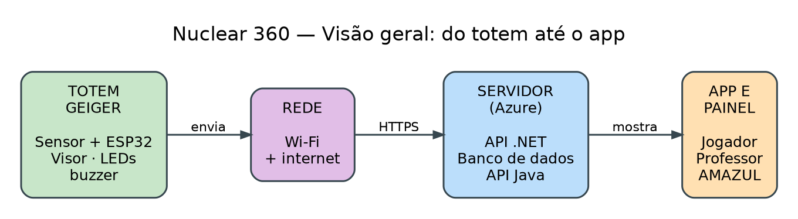
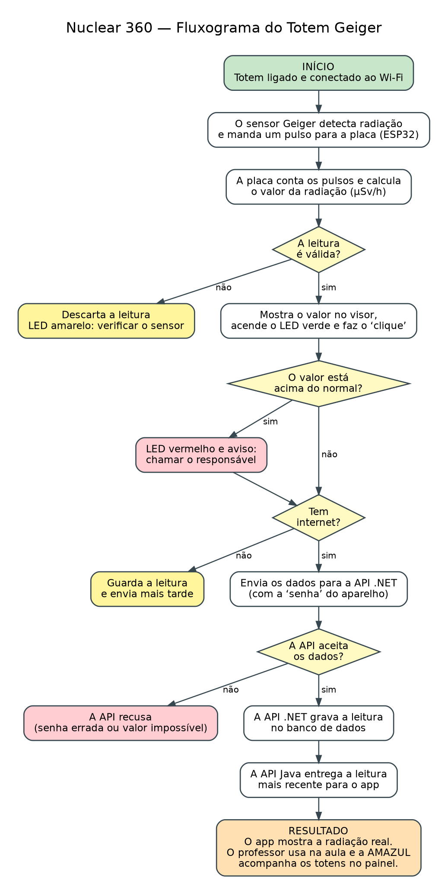

# Nuclear 360 — Proposta de IoT e Redes

**Disciplina:** Disruptive Architectures: IoT, IoB & Generative IA · **Entrega:** 1º Sprint

## Integrantes

Lucas Shida Rodrigues da Costa RM568194
Matheus Guimarães Rosa RM567912
Pedro Henrique Pinheiro Falchi RM566967

Turma: 2TDSPS

## Materiais deste repositório

| Material | Onde |
|---|---|
| Visão geral do sistema | `docs/img/visao-geral.png` |
| Fluxograma | `docs/img/fluxograma.png` |

## 1. O projeto e o problema

O **Nuclear 360** é o aplicativo do nosso grupo para o desafio da Marinha (AMAZUL). É um jogo com quiz e simuladores que ensina o que a tecnologia nuclear faz de bom (saúde, agricultura, indústria, pesquisa e energia) e desmonta mitos usando fontes oficiais.

**O problema:** radiação não dá para ver nem ouvir, e o celular não consegue medir radiação. Por isso, o contador Geiger que fica dentro do app é só uma simulação. Em palestras, as pessoas escutam a explicação, mas não veem uma medição de verdade.

## 2. A nossa ideia: o Totem Geiger

O **Totem Geiger** é um aparelho que ficaria em eventos da AMAZUL e em escolas. Ele **mede a radiação natural do ambiente** (aquela que existe em qualquer lugar) e mostra o resultado:

- no próprio totem, com visor, luzes e o "clique" famoso do contador Geiger;
- no **app Nuclear 360**, no celular de quem visita;
- num **painel** para a equipe da AMAZUL.

**Como ajuda o projeto:**

- O app passa a mostrar um **dado real**, e não só uma simulação.
- O professor pode usar a leitura ao vivo para explicar radiação natural na aula.
- A equipe da AMAZUL consegue ver se os totens estão funcionando.

O totem **não usa nenhum material radioativo**. Ele só mede a radiação natural do ambiente.

## 3. Onde usamos IoT e Redes

| Parte | Tecnologia | Para quê |
|---|---|---|
| Totem (sensor + placa) | **IoT** | Medir a radiação e tomar decisões simples, como acender uma luz de aviso |
| Wi-Fi e internet | **Redes** | Levar a leitura do totem até o servidor |
| Servidor na nuvem (Azure) | **Redes** | Receber, guardar e entregar os dados ao app |

## 4. Componentes: o que usaríamos e para quê

| Componente | Para que serve | Onde fica |
|---|---|---|
| Sensor Geiger (tubo Geiger-Müller) | **Detecta** a radiação: dá um "pulso" elétrico cada vez que detecta uma partícula | No topo do totem |
| Placa ESP32 | É o "cérebro": conta os pulsos, calcula o valor e envia pela internet (já vem com Wi-Fi) | Dentro do totem |
| Visor (display) | Mostra o valor da radiação | Na frente do totem |
| LEDs verde, amarelo e vermelho | Mostram se está tudo normal, se há erro ou se o valor está alto | Na frente do totem |
| Buzzer | Faz o "clique" a cada pulso e toca o aviso | Dentro do totem |
| Bateria externa (power bank) | Dá energia ao totem | Na base |
| Roteador Wi-Fi ou 4G | Conecta o totem à internet | No local do evento |
| Servidor no Azure | Roda a API .NET, a API Java e o banco de dados | Na nuvem |
| App Flutter e painel | Mostram os dados para quem usa | Celular e computador |

## 5. Comunicação: como os dados viajam

| Trecho | Como se comunica |
|---|---|
| Sensor → placa | O sensor manda um pulso elétrico para a placa a cada partícula detectada |
| Placa → internet | Pelo **Wi-Fi** do evento (ou de um roteador 4G) |
| Placa → API .NET | Envia a leitura pela internet usando **HTTPS**, junto com uma "senha" que identifica aquele totem |
| API .NET → banco | Grava a leitura no banco de dados |
| App → API Java | O app pergunta de tempos em tempos qual é a leitura mais recente e mostra na tela |

**Detalhes importantes:**

- A placa envia uma leitura **a cada poucos segundos** (por exemplo, 10 s). Esse valor ainda pode ser ajustado.
- Se a **internet cair**, o totem guarda as leituras e envia quando voltar. Ele continua funcionando no visor.
- A placa ESP32 só usa Wi-Fi de 2,4 GHz. Se o local não tiver, levamos um roteador 4G.
- Cada totem tem a sua "senha". Se um totem der problema, o servidor pode bloquear só ele.

## 6. Fluxograma: do dado até o resultado

**Resumo:**

1. O totem liga e conecta ao Wi-Fi.
2. O sensor detecta a radiação e a placa calcula o valor.
3. Se a leitura for estranha, ela é descartada e o LED amarelo acende.
4. Se for válida, aparece no visor, o LED verde acende e o buzzer faz o clique.
5. Se o valor estiver acima do normal, o LED vermelho acende e o totem pede para chamar o responsável.
6. Se houver internet, a leitura é enviada à API .NET. Se não, fica guardada para depois.
7. A API confere a "senha" e se o valor faz sentido. Se estiver tudo certo, grava no banco.
8. A API Java entrega a leitura para o app, que mostra a radiação real.

## 7. O que a solução gera (respostas e benefícios)

| Situação | O que acontece |
|---|---|
| Leitura normal | Luz verde, clique e valor no totem e no app |
| Valor acima do normal | Luz vermelha e aviso para chamar o responsável |
| Leitura estranha (erro do sensor) | Luz amarela e a leitura é descartada |
| Totem sem internet | Guarda as leituras e envia depois; no painel aparece como "offline" |
| Senha do totem errada | O servidor recusa os dados |

**Quem usa os dados:** o **jogador** (vê a radiação real no app), o **professor** (usa na aula) e a **equipe da AMAZUL** (acompanha os totens pelo painel).

## 8. Tecnologias previstas

- **Totem:** placa ESP32, sensor Geiger-Müller, visor, LEDs e buzzer.
- **Comunicação:** Wi-Fi, internet e HTTPS.
- **Servidor:** máquina virtual no Azure com Docker, API .NET, API Java e banco de dados.
- **Telas:** app Flutter e painel web em .NET.

## 9. O que ainda precisamos definir

- Qual modelo de sensor Geiger vamos usar e como calibrá-lo.
- A partir de qual valor o totem considera "acima do normal". Isso deve ser combinado com a AMAZUL.
- Onde os totens ficariam e qual é a internet disponível em cada evento.

**Observação:** o totem é uma demonstração educativa e não substitui um aparelho de medição profissional.

## 10. O que tem de diferente na nossa ideia

- A radiação passa a ser algo que se **vê e se ouve** (luzes e clique).
- O dado real entra **dentro do jogo**, e não fica só numa tela separada.
- É uma solução de **baixo custo**, que pode ser repetida em várias escolas.
